# Kaoto 2.14 released

We are happy to announce that a new version of the extension has been released!

## Key highlights of this release

This release focuses on three themes: a more accessible and easier-to-navigate **canvas** with keyboard navigation, a single shared hover toolbar and a "Recently used" row in the catalog; further **DataMapper** improvements, including automatic `xsl:if` guards for optional mappings and the ability to store the transformation result in a Camel variable; and **Citrus test designer** support for Camel infra services. It also ships a fix to how the extension looks up its `.kaoto` metadata file, and the latest Kaoto catalog, which includes **Apache Camel 4.23.0**.

---

### Canvas: Keyboard navigation

The route canvas can now be used entirely from the keyboard:

- **Skip link** — a "Skip to canvas" link jumps straight to the canvas, bypassing the masthead
- **Arrow keys** — move between nodes and groups on the canvas with `←` `→` `↑` `↓`
- **Escape** — clears the current node selection
- **Focus restoration** — closing the side panel returns focus to the previously selected node

    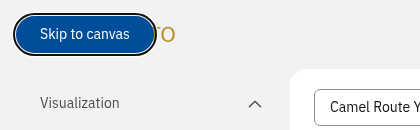

Press `Tab` right after the page loads and the **Skip to canvas** link appears in the top left corner.

---

### Canvas: A single, animated hover toolbar

Moving the mouse between nodes and groups could previously leave several hover toolbars visible at the same time. The canvas now renders **one shared toolbar** that follows the element you hover, animates smoothly between targets (respecting the _reduced motion_ OS setting) and stays reachable for a short grace period when the pointer moves towards its buttons.

    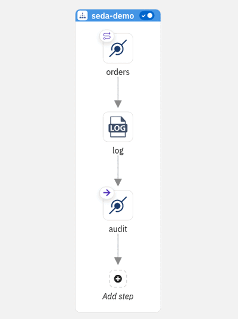

---

### Catalog: Recently used quicklinks

A new **Recently used** row is shown below the catalog filters, so you can pick the components, processors, or Kamelets you use most without searching for them again. The 10 most recent selections are kept, and they respect the compatibility restrictions of the current catalog context.

    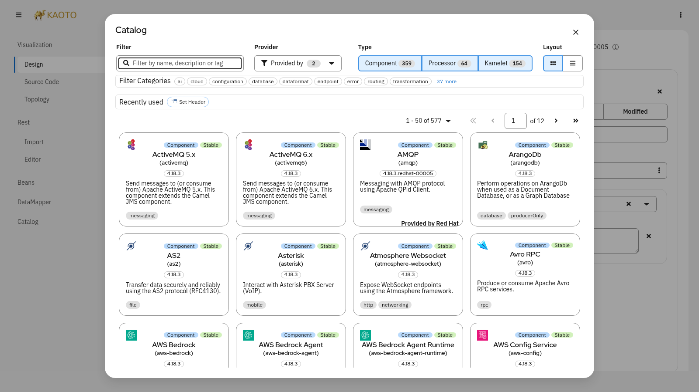

---

### DataMapper improvements

- **Automatic `xsl:if` for optional mappings** — when both the source and the target field of a mapping are optional (`minOccurs=0`), the mapping is wrapped with an `xsl:if` that checks the source is present, so the target element is only produced when there is something to map
- **Save as variable** — a new optional **Save as variable** setting, available  in the DataMapper launcher panel and in the DataMapper settings, stores the transformation result in a named Camel variable by adding a `setVariable` step to the DataMapper step group
- **`Add copy selector` placement** — the new `xsl:copy-of` node is now rendered at the top of the field children, next to where you invoked the action, like `Add Variable`. In the previous version, the new `xsl:copy-of` node was added to the bottom, which could be out of view when there are many children
- **`copy-of` availability** — `Add copy selector` is no longer offered on leaf fields or on JSON targets, where it does not apply

    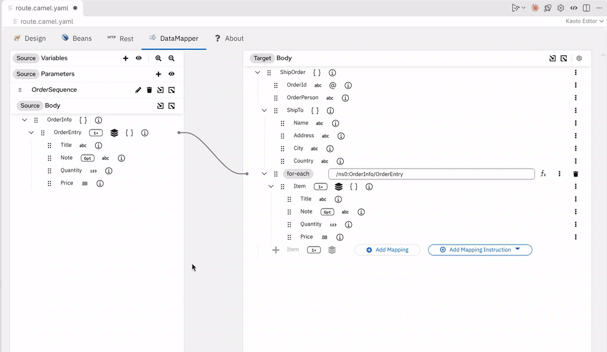

    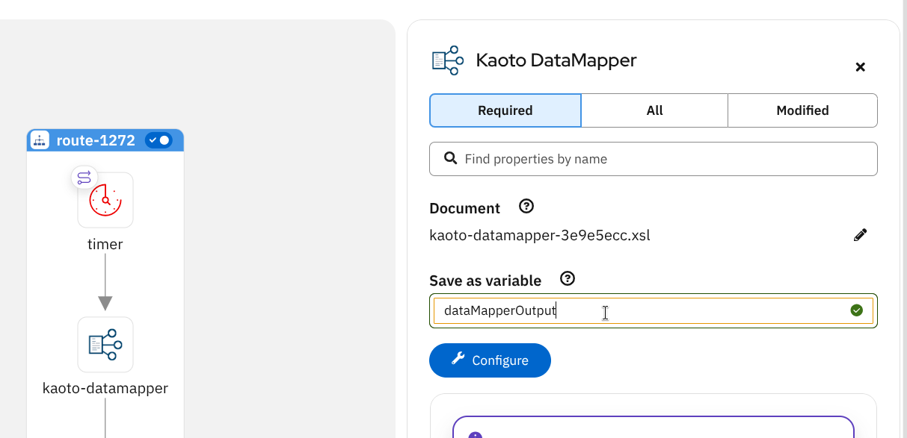

    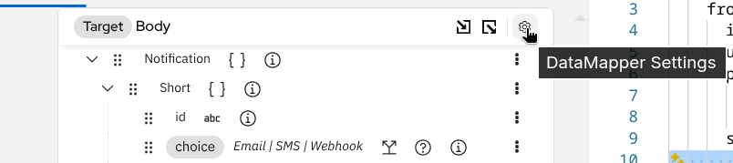

    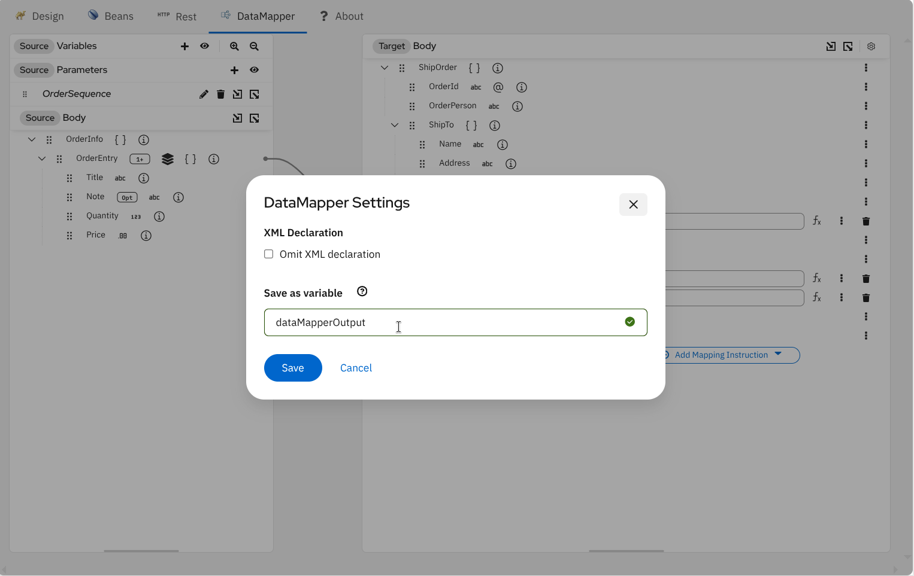

---

### Citrus test designer: Camel infra services

The `camel-infra-run` and `camel-infra-stop` test actions now offer catalog-backed **Service** and **Implementation** fields. Services are grouped by prefix (for example `kafka.strimzi`, `aws.s3`, `google.pub-sub`), and the implementation list is filtered by the selected service.

    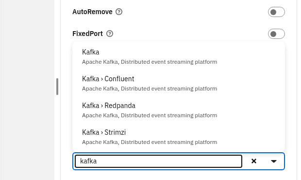
    &nbsp;
    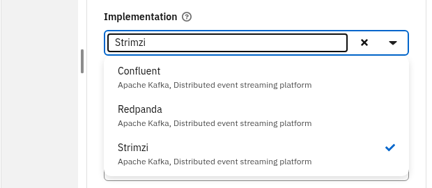

Citrus value fields also offer **suggestions**: press `Ctrl+Space` (or use the lightbulb) to pick from the **test variables** defined in the test and from the available Citrus **functions**.

    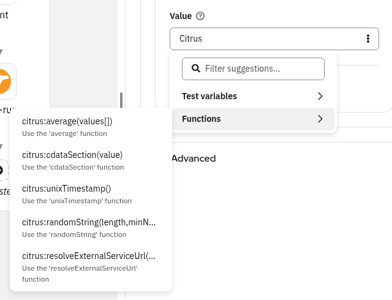

---

### Editor improvements and fixes

- **Seda endpoints** — the Seda configuration form now has a **Create Route** button, like Direct, and Seda nodes display their queue name on the canvas
- **String path parameters are preserved** — URI path parameters typed as `string` in the catalog are no longer coerced to numbers. For example, `kamelet:delay-action/001` no longer turns into `kamelet:delay-action/1`
- **Kamelet icon in exported documentation** — the Kamelet icon is now written as a separate file in the documentation zip instead of being inlined as a base64 data URI, which not every Markdown renderer supports

    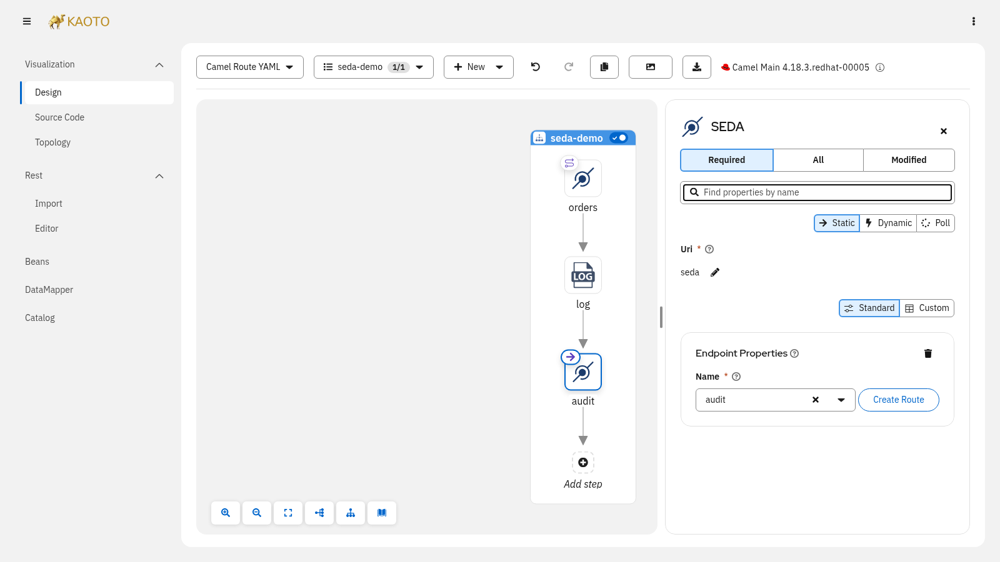

---

### `.kaoto` metadata lookup stops at the workspace root

The extension no longer walks up the file system looking for a `.kaoto` metadata file. The lookup now stops at the workspace folder, so a `.kaoto` file in your home directory is no longer picked up by every project below it and the metadata of different projects is no longer mixed.

> **Note:** an existing `~/.kaoto` file is now ignored and left untouched. For routes in a workspace, new metadata is stored in `.kaoto` at the workspace root. For routes outside a workspace, metadata is stored in `.kaoto` beside the route.

---

### Camel Catalog

This release ships with `@kaoto/camel-catalog 0.10.7`, which adds the **Apache Camel 4.23.0** catalog alongside 4.22.2, 4.18.4 and 4.14.9, bringing the latest components, EIPs, and Kamelet definitions from the Apache Camel community.

---

For a full list of changes please refer to the [change log.](https://github.com/KaotoIO/kaoto/releases/tag/2.14.0)

### Let's Build it Together

Let us know what you think by joining us in the [GitHub discussions](https://github.com/orgs/KaotoIO/discussions).
Do you have an idea how to improve Kaoto? Would you love to see a useful feature implemented or simply ask a question? Please [create an issue](https://github.com/KaotoIO/kaoto/issues/new/choose).

### A big shoutout to our amazing contributors

Thank you to everyone who made this release possible!

Whether you are contributing code, reporting bugs, or sharing feedback in our [GitHub discussions](https://github.com/KaotoIO/kaoto/discussions), your involvement is what keeps the Camel riding! 🐫🎉

